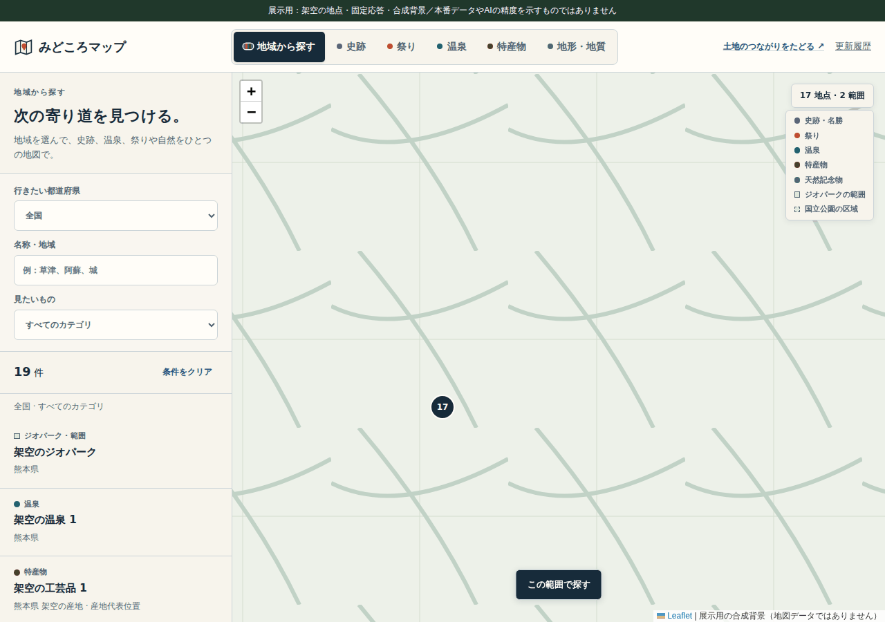
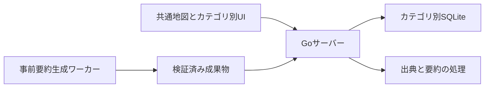

# みどころマップ

史跡、祭り、温泉、特産物、地形と地質を、同じ地図で探すWebアプリです。
都道府県や名称でカテゴリを横断して検索し、地点の詳細を読んだ後も探索位置へ戻れます。

このリポジトリは、アプリのGoソース、共通地図UI、検証方法を独立させたポートフォリオです。
[既存の公開アプリ](https://midokoro-map.ats030.workers.dev/)と、以下の[操作動画](docs/media/walkthrough.webm)から画面の流れを確認できます。



**展示は架空の地点、固定応答、合成した背景を使っています。**
実際の地理情報、旅行先の情報、AI要約の品質を示すものではありません。
[地域検索](docs/media/02-region.png)、[詳細表示](docs/media/03-detail.png)、[スマートフォン](docs/media/06-mobile.png)の静止画も収録しています。

## 解決する課題

カテゴリごとに別の地図を開く構成では、同じ地域の史跡と温泉を比較するたびに探し直す必要があります。
みどころマップは一つのLeaflet地図を共有し、地域を決めてから複数のカテゴリを比較できるようにしています。
詳細を閉じる操作やURLの復元も、探索を続けるための機能として実装しています。

## コードから読める設計判断

| 課題 | 対応 | 根拠を読める場所 |
| --- | --- | --- |
| カテゴリ切替で地図と操作位置がばらばらになる | 一つの地図を共有し、レイヤーとイベントをカテゴリごとに切り替える | [runtime.js](frontend/runtime.js) |
| 画面を統合するとIDやスタイルが衝突する | カテゴリのDOMをShadow DOMへ分け、既存UIの参照先を限定する | [runtime.js](frontend/runtime.js)、[カテゴリ別画面](frontend/assets) |
| 大きいカテゴリだけが検索一覧を占める | 横断検索の結果をカテゴリごとに交互に並べる | [探索モデル](frontend/assets/explore/model.mjs) |
| 範囲の検索で区域内外を誤解させたくない | 点とポリゴンの交差を調べ、表示用形状による判定の限界を扱う | [探索モデルとテスト](scripts/test-explore.mjs) |
| AI要約の処理失敗を「情報なし」と扱いたくない | 要約あり、確認済み情報なし、再試行を区別する | [PreparedSection](internal/shared/prepared_summary.go) |
| 古い要約を新しい原文の検証結果として扱いたくない | 入力ハッシュと節ごとの完了状態で再開や公開可否を判断する | [事前生成ワーカー](cmd/warm-all)、[データの照合](internal/shared/summary_roster.go) |

これらは公開コードで確認できるプロジェクトの実装です。
個人の発案や担当範囲、速度改善率は確認や測定なしで実績として記載していません。
[地図共有の設計事例](docs/shared-map.md)に、統合の仕組みと検証範囲をまとめています。

## 構成



図はGo版の責務分担です。
公開アプリのCloudflare版は、スナップショットの配信と外部APIの処理をWorker側で行います。
この公開リポジトリの展示用サーバーはPythonで固定応答を返すため、GoやWorkerの本番APIとは区別してください。
[構成と収録範囲](docs/architecture.md)に違いを記載しています。

## 展示をローカルで開く

Python 3.12以上を使います。
この展示用サーバーの起動には、追加パッケージやAPIキーは必要ありません。

```sh
git clone https://github.com/ats030/midokoro-map.git
cd midokoro-map
python3 scripts/run_demo.py
```

`http://127.0.0.1:8541/` を開きます。
19件の合成データで、地域と名称の検索、カテゴリ切替、詳細表示を操作できます。
地点や区域の名称と説明は架空です。
地図の背景も実際の地図タイルを使いません。
展示用サーバーはローカルだけで待ち受け、外部APIへ要求を転送しません。

展示は検索画面の確認用です。
本番APIの完全互換、実データの配信、AI要約生成、写真取得、特集ページの閲覧は展示の対象に含めていません。

## Go本体のビルドと検証

Go 1.25とNode.jsを使います。
依存関係は `go.mod` と `go.sum` に収録しています。

```sh
mkdir -p .local
go build -buildvcs=false -o .local/app-server ./cmd/server
python3 scripts/run_checks.py
```

`run_checks.py` は一時ディレクトリへ公開ソースをコピーし、合成SQLiteを生成してGoテストとビルドを実行します。
探索モデルと画像出典表示のJavaScriptテストも実行します。
実データ1919件を必要とする特産物のカタログ検査は収録していません。
任意の本番データがない場合にスキップする既存テストは、そのまま結果へ記録します。
Go本体の起動にはカテゴリ別SQLiteや配信データが必要で、元の実データはこの公開版に同梱していません。

別の場所にある既存コマンドを使う場合は、`MIDOKORO_GO` と `MIDOKORO_NODE` で実行ファイルを指定できます。
[検証記録](docs/validation.md)と[機械的な検証結果](docs/check-report.json)に、実施した範囲を記載しています。

## 画面資料の再生成

```sh
python3 -m venv .venv
.venv/bin/python -m pip install -r requirements-dev.txt
.venv/bin/python -m playwright install chromium
.venv/bin/python scripts/capture_portfolio.py
.venv/bin/python -m pytest scripts/test_publication_audit.py -q
.venv/bin/python scripts/audit_publication.py
```

撮影では展示用サーバーを一時ポートで起動し、ブラウザの外部リクエストを拒否します。
地域検索、名称検索、詳細とEscape、空結果、全カテゴリの件数、地図位置の保持、390pxでの表示、URLからの条件復元を検査します。
6枚の画面、GIF、WebMと[撮影記録](docs/media/capture-report.json)を生成します。
公開検査はGitのステージされた内容を確認するため、変更後に実行する場合は、先に確認済みのファイルをステージしてください。

## AIの利用と公開範囲

「土地のつながりをたどる」の下書き生成を、Ollamaで試せる[実験用の処理](docs/story-automation.md)も収録しています。
候補の選択、公式資料の変更検査、1件の生成、非公開プレビューを分けています。
生成結果の公開と定期実行は有効にしていません。

この公開版の整理、説明文、展示と検証のスクリプトには生成AIを利用しています。
元の開発で誰が個々の設計を発案したかや、人とAIの実装比率は主張していません。
AI要約の入力管理や失敗時の扱いは、コードとテストから評価できる形にしています。

運用リポジトリの履歴、認証情報、実カタログDB、外部写真、要約キャッシュ、未コミットの変更は収録していません。
第三者のコードの通知は[THIRD_PARTY_NOTICES.md](THIRD_PARTY_NOTICES.md)、元のソースと公開用変更は[source-manifest.json](docs/source-manifest.json)を参照してください。
プロジェクト全体へのオープンソース再利用ライセンスは、この公開では設定していません。
