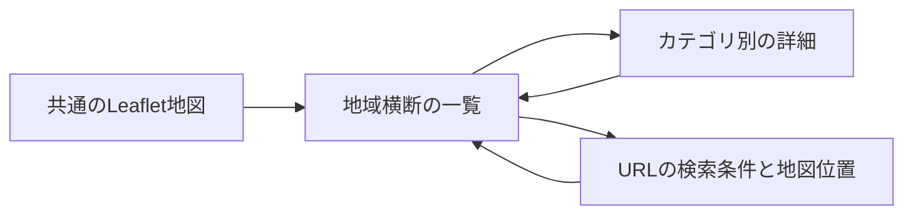

# カテゴリを切り替えても探索を続ける設計

## 地図を共有する理由

同じ地域の史跡と温泉を比べるときは、表示範囲を変えずにカテゴリを切り替えられると、探索の位置関係を保てます。
[runtime.js](../frontend/runtime.js)はLeafletの地図を一つだけ作り、現在のカテゴリへそのコンテナを移します。
カテゴリごとのレイヤーとイベントを管理し、非表示のカテゴリによる地図の操作を制限します。

## 既存画面との境界

各カテゴリのDOMはShadow DOMに置きます。
同じ `keyword` や `detail-panel` というIDを使っていても、そのカテゴリの画面内で参照できます。
カテゴリの取得経路も `context.fetch` が `/api/<kind>/` に変換し、共通の入口に接続します。

## 詳細を開いて戻る

地域横断の一覧では、選んだ項目のカテゴリ画面を詳細用に読み込みます。
閉じる操作では、探索画面の選択状態を更新し、元の操作対象へフォーカスを戻します。
都道府県、名称、カテゴリ、地図位置、選択項目をURLへ保存するため、共有や再読込みの後でも条件を復元できます。

## 今回の検証

架空の19件を使い、熊本県で11件、名称を絞って2件、存在しない名称で0件になることを展示で確認しました。
地形の件数は点と区域を含むため、実際の訪問先の件数とは異なります。
詳細をEscapeで閉じる操作、カテゴリ切替時の地図位置、スマートフォンの地域選択、再読込み後の条件復元も通過しました。
合成背景での操作検査なので、実際の地図精度や外部APIの応答を評価したものではありません。
